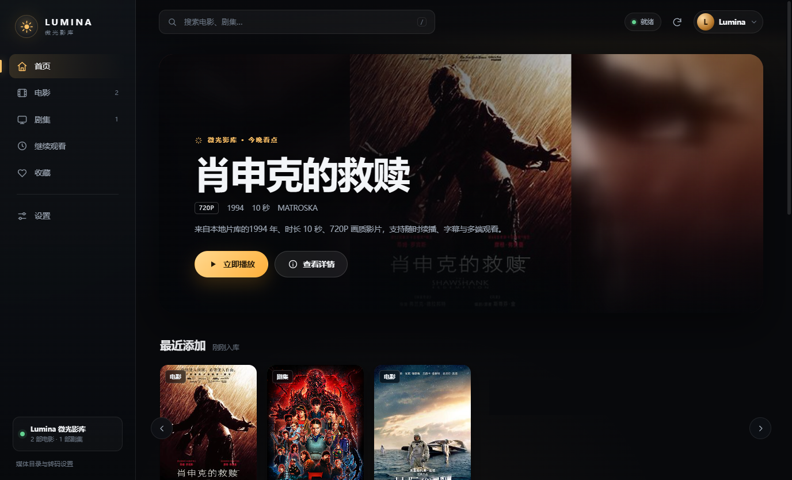
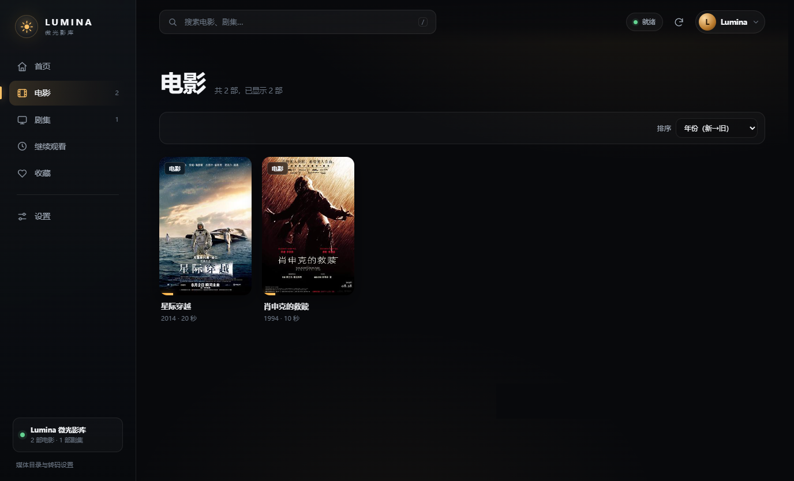
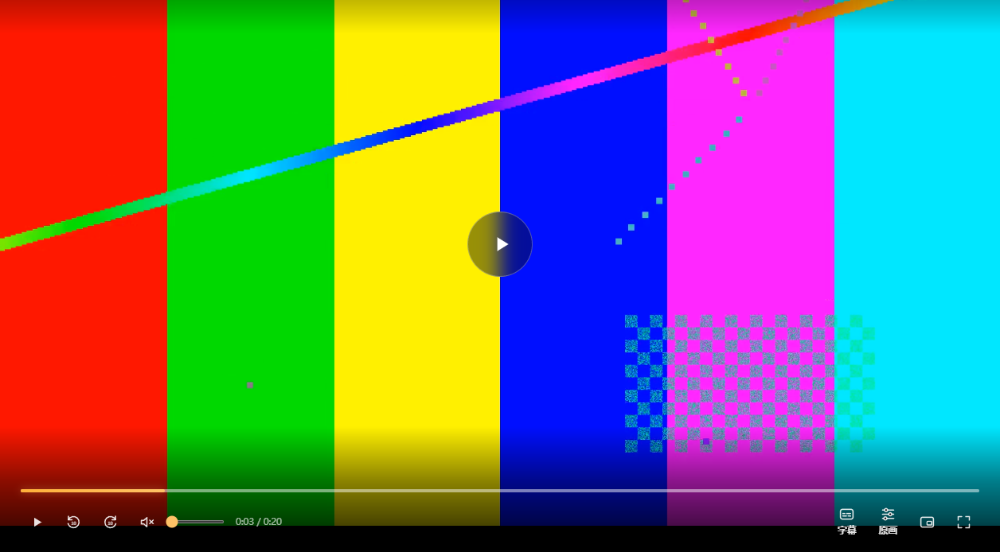

# Lumina 体验记录与改进建议

> 体验环境：Windows 11 + Chrome，桌面 1256×774，移动端 492×850。截图使用测试媒体库，账号名称已隐藏，路径做了泛化处理。

## 先说我喜欢的部分

- **整体的“影院感”很统一**：深色底、金色强调色、海报墙、Hero 大图和详情页背景的层次一致，不像临时拼出来的后台。
- **扫描识别省心**：`星际穿越 (2014).mp4`、`Stranger Things - S01E01.mkv` 这类文件名能直接识别成电影/剧集，季集信息也正确。
- **直连与转码的取舍合理**：MP4/H.264 直接播放，MKV/HEVC 自动走 HLS；用户不需要理解编码格式。
- **详情页信息密度不错**：播放、收藏、元数据、字幕、分级都在同一屏，管理员和普通成员的按钮差异也做了。
- **移动端底部导航、返回关闭播放器、收藏、字幕切换**这些容易忽略的细节都处理了。
- **元数据/字幕流程完整**：搜索候选、预览、应用、海报代理、字幕下载都能串起来；没有网络时错误提示也算清楚。

## 2026-11 更新：10 条建议已全部落地

- [x] 大库分页：电影/剧集/收藏/继续观看按 48 条分批，显示“已显示 M / 共 N”，加载更多递增。
- [x] 简介可读性：默认 4 行 + 半透明遮罩，支持展开/收起；关于卡片单独 6 行。
- [x] 设置页过长：改为媒体库/用户/元数据/服务器/转码/概览六个分区，移动端标签横向滚动，保存栏 sticky。
- [x] 详情操作收敛：播放/继续观看 + 心形收藏 + 更多菜单，管理操作收进更多。
- [x] 单库工具栏：只有一个可见库时只保留排序；多库才显示分类标签。
- [x] 元数据候选：无海报占位、来源标注、无简介提示、剧集“保留各集标题”选项。
- [x] 字幕弹窗：紧凑空状态 + 重新搜索/重试，语言支持中文/English/全部并记住上次选择。
- [x] 收藏/继续观看：复用媒体库分类与排序，选择按页面独立保存。
- [x] 首次管理员：出生日期改为可选，之后可在个人资料补填。
- [x] 无障碍：播放器图标按钮 aria-label、全局 focus-visible、收藏按钮键盘可见。

原始体验记录保留在下方，便于对照。

## 建议优先改的地方

### 1. 大媒体库的列表性能（P0）

当前电影/剧集页一次性渲染全部卡片。测试库只有 2 部时很轻，但真实库到 1000+ 部时，首屏 DOM、海报请求和滚动都会变重。

建议：

- 服务端分页，或前端“加载更多”/虚拟列表；
- 海报 `loading="lazy"` + 固定宽高占位，避免图片加载时抖动；
- 顶部显示“共 N 部，已显示 M 部”；
- 排序/筛选放到服务端，避免每次切换都在浏览器里重排全部数据。

### 2. 详情页简介的可读性（P1）

现在简介直接叠在背景图上，遇到浅色海报或长文本时对比度不够；5 行截断后也没有“展开”。

建议：

- 给简介区域加一层半透明深色底或更明显的渐变遮罩；
- 默认 4–5 行，提供“展开/收起”；
- 长简介在移动端不要挤压播放按钮，可以放到“关于这部影片”卡片里。

### 3. 设置页太长（P1）

设置页从媒体库、用户、服务器、元数据一直到转码，页面高度约 2700px，找一个选项要滚很久。

建议：

- 左侧或顶部增加分区导航（媒体库 / 用户 / 元数据 / 服务器 / 转码）；
- 移动端用折叠面板，默认只展开常用项；
- 保存按钮做成 sticky，滚动时仍能看到。

### 4. 详情页操作按钮偏多（P1）

管理员在详情页会看到“继续观看 / 从头播放 / 收藏 / 匹配元数据 / 在线字幕 / 返回电影”，移动端会换行成两三排。

建议：

- 主操作只保留“播放/继续观看”；
- 收藏做成图标按钮；
- “匹配元数据”“在线字幕”收进“更多”菜单；
- 成员和管理员分别控制操作区密度。

### 5. 工具栏在单媒体库时略显空（P2）

只有一个可见媒体库时，左侧仍会显示“全部 2”，右侧是排序，整条工具栏看起来有点空。

建议：

- 单库时隐藏“全部”标签，只保留一个紧凑的排序控件；
- 多库时再显示分类标签；
- 分类标签较多时支持横向滚动和“更多”。

### 6. 元数据候选的可用性（P2）

- 没有海报的候选会留下灰色空块，可以加统一的占位图；
- 结果里可以补充“来源/语言/简介长度”，让用户更容易判断；
- 豆瓣条目经常没有简介，应用时可以保留原简介（现在已处理），并在 UI 上提示“该来源无简介”；
- 剧集匹配后建议提供“只应用剧集信息，不改单集标题”的选项。

### 7. 字幕弹窗的空状态（P2）

没有字幕时，弹窗中间会留出很大一块空白，只显示两行提示。建议把空状态压缩到顶部，并直接给出“换语言/换关键词”的操作按钮。

另外语言目前只有中文/英文，可以增加“自动/全部语言”，或者记住上次选择。

### 8. 收藏与继续观看也可以复用排序/分类（P2）

现在排序和媒体库分类只在电影/剧集页。收藏页和继续观看页同样适合按“最近添加/标题/年份”排序，尤其是收藏很多的时候。

### 9. 首次创建管理员时的出生日期（P2）

管理员本身不受年龄限制，但首次 setup 仍要求填写出生日期，会让第一次启动多一步。

建议：

- 首个管理员把出生日期设为可选；
- 或者文案明确写“管理员不受年龄限制，出生日期仅用于个人资料”。

### 10. 无障碍与细节（P3）

- 播放器的图标按钮建议补 `aria-label`（至少播放、音量、全屏、PiP、字幕、画质）；
- 卡片心形按钮在桌面端只在 hover 时出现，键盘用户不容易发现，可以加 `focus-visible`；
- 设置页、用户管理里的次要文字对比度可以再提高一点；
- 加载状态可以加骨架屏，减少“先空白再出现”的感觉。

## 截图

| 首页 | 电影库 |
| --- | --- |
|  |  |

| 详情页 | 播放器 |
| --- | --- |
|  |  |

## 结论

Lumina 已经是一个“能日常用”的局域网影音站，核心链路（扫描 → 浏览 → 播放 → 续播 → 权限/分级 → 收藏 → 元数据/字幕）是通的。上述 10 条建议完成后，大库首屏、详情页信息层级、设置页导航和移动端操作密度都已改善；下一步可以继续做**服务端分页/虚拟列表**、**更多元数据源**和**播放器字幕样式设置**。
